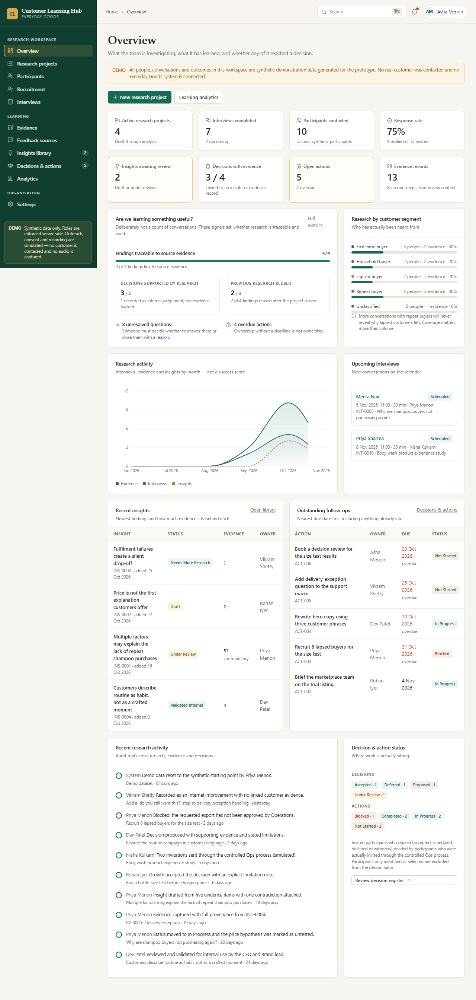

# Customer Learning Hub — Everyday Goods

An evidence-first customer research workspace. Plan a study, recruit synthetic participants,
run the conversation, capture what customers actually said, turn it into a reviewed insight,
and connect that insight to a business decision with a named owner and a due date.

The demo deployment is seeded with **synthetic data only**; seeding is off by default, so a
production instance starts empty and is claimed by its first administrator. No real customer is
contacted, no Everyday Goods system is connected, no audio is recorded and no contact details
are stored.



---

## The business problem

Everyday Goods teams struggle to coordinate customer research, find earlier studies, preserve
the customer's own words, keep contradictory evidence, and connect learning to decisions. The
product makes that chain explicit and auditable:

```
Research question → Project → Recruitment → Interview → Evidence → Insight → Decision → Action
```

It also refuses to flatter the sample: small studies are labelled as such, unevidenced decisions
are marked as internal judgement, missing provenance is flagged, and metrics that need a
baseline are shown as "pending" instead of invented.

## Quick start

### Docker (no Python or Node required)

```bash
docker compose up --build
```

| What | Where |
| --- | --- |
| Web app | http://localhost:8081 |
| API | http://localhost:8000/api/v1 |
| OpenAPI docs | http://localhost:8000/docs |

Wait for both containers to report healthy. The API creates the schema, seeds the synthetic
dataset on first start, and nginx proxies `/api` on the same origin.

```bash
docker compose logs -f backend
docker compose down           # keep the demo database
docker compose down -v        # delete it; next start reseeds
```

Host port 8081 is used because 8080 is often occupied. The container listens on 8080.

### Windows local development (PowerShell)

```powershell
cd backend
python -m venv .venv
.venv\Scripts\Activate.ps1
pip install -r requirements.txt
.venv\Scripts\python.exe -m uvicorn app.main:app --reload --port 8000
```

```powershell
cd frontend
npm ci
npm run dev        # http://localhost:5173
```

Vite proxies `/api` to `http://127.0.0.1:8000`, so no CORS setup is needed locally.
Configuration lives in `backend/.env` (copy `.env.example`); every value has a demo-ready
default.

### Database and migrations

SQLite by default at `backend/data/clh.db`. The API creates missing tables at startup. For a
managed database:

```powershell
cd backend
.venv\Scripts\python.exe -m alembic upgrade head
```

Set `DATABASE_URL` to a PostgreSQL URL to change engines; the models use portable types. See
`docs/database.md`.

### Reset or reseed

`POST /api/v1/demo/reset` with `{"confirm": true, "phrase": "RESET"}` rebuilds the dataset. The
seed is idempotent: it is skipped when users already exist.

## What the prototype does

| Area | Capability |
| --- | --- |
| Projects | Create from template or blank, edit, archive, questions, target segments, owner, filters |
| Participants | Synthetic directory, segment and eligibility filters, purchase context, participation history; no contact fields accepted |
| Recruitment | Ten-stage pipeline, append-only history, segment coverage, defined response-rate denominator |
| Interviews | Schedule, reschedule, cancel, complete, neutral guide, consent records, notes, summary, follow-up questions |
| Feedback sources | Interviews, written feedback, structured forms, short surveys, support feedback, product reviews, manual entries and CSV imports in one provenance-preserving record; explicit depth labels; verification requires a source reference |
| Evidence | Five types, provenance and verification status, review action, correction, supporting and contradictory links |
| Insights | Create, edit, link/unlink evidence, confidence, limitations, review, related research |
| Decisions | Problem, rationale, limitations, linked sources, owner, status; unevidenced decisions labelled |
| Actions | Owner, due date, priority, status, overdue tracking |
| Overview | Derived metrics, segment coverage, timeline, outstanding follow-ups, activity trail |
| Analytics | Basis-labelled metrics, reuse detail, unresolved questions, measurement gaps |
| Search | Deterministic search across seven entity types, with related-research suggestions |
| Exports | Nine CSV entities, including feedback sources, with correct headers, Unicode, formula-injection safety, audit logging and empty-dataset handling |
| Settings | Organisation name, research lead, recording default, retention months, demo reset |
| Authentication | Email + password, PBKDF2 hashing, server-side sessions in an HTTP-only cookie, sign-out, password change |
| Authorisation | API-enforced roles on every write; the browser cannot assert a role |
| Demo entry | Role picker that issues a real session, available only while demo mode is enabled |

## Architecture

A modular monolith:

```
React 18 + TypeScript (Vite) ── /api/v1 ──▶ FastAPI ── SQLAlchemy 2 ──▶ SQLite (PostgreSQL-compatible)
        TanStack Query                      routers → services → models
        React Router                        one error envelope, structured logs
```

- **Backend:** FastAPI, Pydantic v2, SQLAlchemy 2, Alembic, pytest, HTTPX. Routers handle HTTP;
  `app/services/` owns metrics, search, serialisation, templates and pipeline rules.
- **Frontend:** React 18, TypeScript, Vite, Bootstrap 5, React Router, TanStack Query,
  React Hook Form + Zod, Recharts, Lucide. The Executive Emerald design system lives in
  `frontend/src/styles/emerald.css`; its source of truth is
  `design-system/customer-learning-hub/MASTER.md`.
- **Infrastructure:** two Docker images, Compose with a persistent volume, health checks,
  nginx reverse proxy, idempotent seed.

Read `docs/hld.md`, `docs/lld.md` and `docs/architecture.md` for detail.

## Repository layout

```
backend/
  app/api/v1/endpoints/   HTTP endpoints
  app/services/           dashboard, analytics, search, serializers, pipeline, activity
  app/models/             SQLAlchemy models
  app/schemas/            Pydantic contracts
  app/seed/               synthetic demo dataset
  alembic/                migration environment and initial revision
  tests/                  91 pytest tests, including auth, feedback and export suites
frontend/
  src/pages/              one component per screen
  src/components/         shared UI, evidence card, search, dialogs
  src/services/api.ts     typed fetch client and error normalisation
  e2e/                    Playwright smoke, accessibility, journey, screenshots
design-system/            Executive Emerald master design system
docs/                     28 canonical documents + original discovery set
compose.yaml              API + nginx web app, one command
```

## Verification

These commands were executed for this release:

```powershell
cd backend
.venv\Scripts\python.exe -m pytest -q                 # 91 passed

cd ..\frontend
npm run typecheck                                     # clean
npm run build                                         # clean (one chunk-size advisory)
npx playwright test                                   # 14 passed

cd ..
docker compose up -d --build                          # both services healthy
```

Run the browser suite against the Docker build:

```powershell
$env:E2E_BASE_URL="http://localhost:8081"
cd frontend; npx playwright test
```

## Security and known limitations

- Synthetic data only; participant contact fields are not accepted by the schema.
- Recording is disabled by default and cannot be enabled without recorded consent. No audio is
  captured.
- **Authentication exists; SSO does not.** Sessions are server-side and roles are enforced by the
  API. There is no identity provider, no email-based password reset and no rate limiting yet; see
  `docs/auth.md`.
- SQLite is single-writer; PostgreSQL is the deployment path.
- Some list screens load all rows rather than paginating.
- Evidence deletion is permanent in this prototype (no tombstone).
- Research activity is never attributed to revenue or repeat-purchase change.

Full lists: `docs/risks.md`, `docs/DEFECT_REGISTER.md`, `docs/tasks.md`.

## Documentation

| Document | Contents |
| --- | --- |
| `docs/prd.md` | Problem, users, requirements, non-goals |
| `docs/architecture.md` | Modules, boundaries, cross-cutting choices |
| `docs/hld.md` / `docs/lld.md` | System design and implementation detail |
| `docs/tech_stack.md` | Pinned versions and deliberate omissions |
| `docs/design.md` / `design-system/customer-learning-hub/MASTER.md` | Palette, contrast pairs, components, motion, required states, accessibility |
| `docs/database.md` / `docs/data_dictionary.md` | Tables, constraints, migrations, generated column reference |
| `docs/api.md` | Endpoint reference, auth requirements, vocabularies |
| `docs/auth.md` | Password sessions, role matrix, known gaps |
| `docs/security.md` | Minimisation, consent, validation, threats |
| `docs/testing.md` | Suites, commands, actual results, gaps |
| `docs/deployment.md` | Docker, Windows, migrations, troubleshooting |
| `docs/backup_recovery.md` / `docs/operations.md` | Verified backup procedure, runbook, incidents |
| `docs/performance.md` | Measured latency and scaling characteristics |
| `docs/accessibility.md` / `docs/troubleshooting.md` | A11y behaviour and real failure modes |
| `docs/integration.md` | Integration status and the contract for adding one |
| `docs/implementation_plan.md` | Delivery plan with dependencies and risks |
| `docs/tasks.md` / `docs/roadmap.md` | Delivered work and what comes next |
| `docs/acceptance_criteria.md` / `docs/requirements_traceability.md` | Verified criteria and requirement mapping |
| `docs/DEFECT_REGISTER.md` | Confirmed defects and gaps |
| `docs/decisions.md` / `docs/risks.md` | ADRs and risk register |
| `docs/changelog.md` | What changed in each release |
| `docs/git_commit_plan.md` | Intended units and commit rules |

The original discovery documents (`docs/01-…` to `docs/20-…`) are retained; `docs/README.md`
maps both sets.

## Licence and provenance

Portfolio prototype built for the Everyday Goods customer-learning exercise. Synthetic data is
generated by `backend/app/seed/demo_data.py`; no third-party customer data is included.
